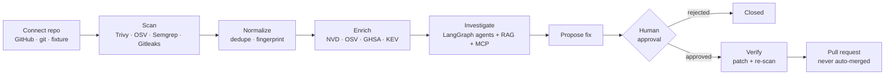

# TRACE

**Agentic Application Security & Vulnerability Intelligence Platform**

> Trace every risk to a verified fix.

   

TRACE scans repositories with real security scanners, normalizes and deduplicates their findings, and enriches them with vulnerability intelligence (NVD, OSV, GitHub Security Advisories, CISA KEV). A LangGraph multi-agent workflow investigates each finding, with retrieval-augmented evidence and MCP tool calls, and proposes fixes. A fix is applied only after human approval, then verified by applying the patch to an isolated snapshot and re-scanning. TRACE also assesses AI/agent applications for prompt-injection and tool-misuse risks, and evaluates its own agents.

## Architecture


How a finding becomes a verified fix:



The full set of diagrams is in **[docs/ARCHITECTURE.md](docs/ARCHITECTURE.md)**: system context, scan sequence, agent graph, RAG pipeline, remediation states, MCP permissions, data model, deployment and the annotated directory layout.

### Repository layout

```text
backend/    FastAPI API · scanners · intel · RAG · LangGraph agents · MCP · evals · tests
frontend/   Next.js console (dashboard, findings, agents, intel, MCP, remediation, evals, reports)
docs/       architecture diagrams
scripts/    tool install · local setup · dev runner
```

## Quick start (local, no Docker)

Requirements: Node 20+, `curl`, `git`, and [Ollama](https://ollama.com) with `qwen2.5-coder:7b` and `nomic-embed-text` pulled.

```bash
scripts/dev-setup.sh     # scanners + uv/Python 3.12 into ./.tools, backend venv, npm install, .env with fresh secrets
scripts/dev.sh           # backend :8000 + frontend :3000
```

Then open http://localhost:3000 and sign in as `admin@trace.example` with the password from `DEMO_ADMIN_PASSWORD` (default `trace-admin`, local only).

On first start the backend:
1. runs migrations;
2. seeds the admin user, organization, built-in MCP server and evaluation datasets;
3. connects `backend/tests/fixtures/vulnerable-app` as a **DEMO** repository and scans it with the real scanners. Demo findings are labeled everywhere and can be filtered out.
4. ingests OWASP and CWE knowledge into the RAG index in the background.

API docs: http://localhost:8000/docs (OpenAPI generated by FastAPI).

## Docker Compose

```bash
cp .env.example .env    # set SECRET_KEY / JWT_SECRET_KEY
docker compose up -d --build
docker compose exec ollama ollama pull qwen2.5-coder:7b
docker compose exec ollama ollama pull nomic-embed-text
```

Compose runs PostgreSQL, Redis + an RQ worker, a Qdrant server, Ollama, the API and the frontend. Containers drop all capabilities, use `no-new-privileges` and run as a non-root user, and the worker has CPU and memory limits.

## Using it

| Area | What it does |
|---|---|
| Repositories | Connect a GitHub repo (App installation or stored token), any public https git URL, or a test fixture. Pick a branch and track commits, scan history and posture. |
| Scans | Choose scanners, run them on an isolated snapshot, view per-scanner status, version, duration and logs. An unavailable scanner is reported as unavailable, never faked. |
| Vulnerabilities | Filter by severity, status, type, scanner, repository, date and text. The detail page shows intel, code, references, investigation, remediation and verification history. |
| AI investigations | Agent timeline with tool calls and decisions, structured facts, model claims flagged as supported or unsupported by citations, confirmed findings vs hypotheses, and a deterministic risk score. |
| Vulnerability intel | Look up any CVE/GHSA/PYSEC id, browse tracked vulnerabilities, sync the KEV catalog, use the RAG search playground, and add approved internal docs. |
| AI security | Static checks of AI/agent code, plus live adversarial probes judged with a random canary (leakage, forbidden tool calls, exfiltration markup, script injection, cross-user access). |
| MCP | Allowlisted server registry and tool discovery. Tools are default-deny, with per-agent permissions, approval for sensitive tools, and an execution log that includes denials. |
| Remediation | Review the diff and approve or reject it, with a justification required when evidence is insufficient. Verify by applying the patch to a snapshot and re-scanning before and after, then open a GitHub PR. Nothing is merged automatically. |
| Evaluations | Built-in datasets (code analysis, prompt-injection resistance, CVE matching). Compare base, RAG and agentic-RAG modes. Only executed runs show metrics. |
| Reports | Executive, repository, vulnerability, AI-security, remediation and evaluation reports, each as PDF or JSON. |
| Settings | Service status, members and roles, encrypted GitHub token, audit trail. |

## Configuration

All configuration is environment-driven. See [.env.example](.env.example) for every option. Key settings:

- `DATABASE_URL`: SQLite (default) or `postgresql+asyncpg://…`
- `REDIS_URL`: enables RQ workers (otherwise jobs run in-process)
- `QDRANT_URL`: Qdrant server (otherwise embedded on-disk mode, which is single-process)
- `MODEL_PROVIDER` and `OLLAMA_*` / `OPENAI_COMPATIBLE_*` / `ANTHROPIC_*`
- `ALLOW_SOURCE_TO_HOSTED_LLM=false` (default): repository code is never sent to hosted models
- `GITHUB_APP_ID`, `GITHUB_APP_PRIVATE_KEY_PATH`, `GITHUB_APP_SLUG`, `GITHUB_WEBHOOK_SECRET`, `GITHUB_TOKEN`
- `NVD_API_KEY`: raises the NVD rate limit

## Security model

- **Untrusted inputs.** Repository content, scanner output and retrieved documents are untrusted. They are delimited as data in prompts and scanned for injection markers. Model-cited evidence ids are validated, and facts such as CVSS, KEV status, fixed versions and the risk score come from structured data, not the model.
- **Scanning.**
  - Snapshots are cloned shallow with hooks disabled and `protocol.file` blocked. Clone URLs must be https.
  - Symlinks that escape the snapshot are removed, size is capped, and the temporary directory is always deleted.
  - Scanners run without a shell, with a minimal environment that never includes app secrets, a timeout with process-group kill, and rlimits.
  - Repository code is never executed.
- **Access.**
  - JWT auth and role-based access (viewer / member / admin / owner), with every query scoped to the organization.
  - Stored tokens are encrypted with Fernet. Logs redact tokens, keys and credentials.
  - Rate limiting and security headers on all responses. GitHub webhook HMAC signatures are verified, and installation permissions are checked.
  - Every sensitive action is written to the audit log.

## Tests

```bash
cd backend && .venv/bin/python -m pytest -q                 # unit + API + end-to-end
cd frontend && npx tsc --noEmit && npx next lint && npx next build
```

The end-to-end test runs a real scan, the LangGraph investigation, a proposal, approval and verification with a real patch and re-scan, then checks the audit trail. It replaces the LLM with `ScriptedTestProvider`, a labeled test double, and stubs intel lookups so the result is deterministic. It is skipped if the scanners aren't installed.

See [docs/STATUS.md](docs/STATUS.md) for what has been verified, what still depends on credentials, and known limitations.

## Contributing, security and license

- Contributions: see [CONTRIBUTING.md](CONTRIBUTING.md).
- Report vulnerabilities privately: see [SECURITY.md](SECURITY.md). The code in `backend/tests/fixtures/vulnerable-app/` is intentionally vulnerable; never deploy it.
- Licensed under the [MIT License](LICENSE).
