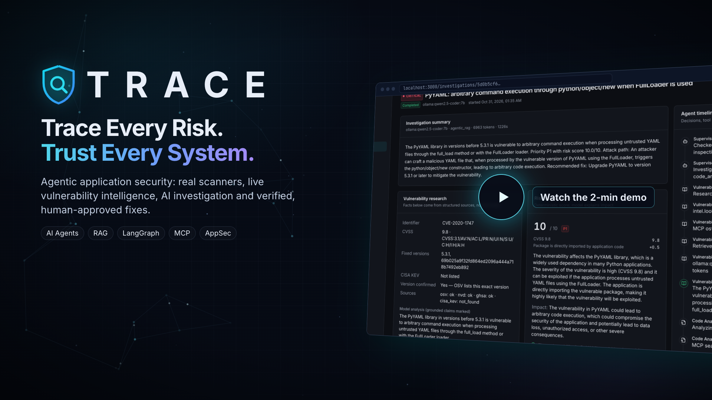
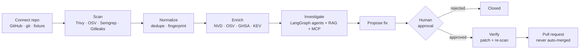

<div align="center">


# T R A C E

### Trace Every Risk. Trust Every System.

**AI-Powered Security & Compliance Intelligence**

[](https://github.com/atique-ahmad-01/trace/actions/workflows/ci.yml)

[](LICENSE)


[Demo](#-demo) · [Features](#-features) · [Architecture](#-architecture) · [Quick start](#-quick-start) · [Production](#production-vercel--render) · [Configuration](#%EF%B8%8F-configuration) · [Security model](#-security-model) · [Tests](#-tests)

</div>

---

TRACE scans repositories with real security scanners, normalizes and deduplicates their findings, and enriches them with vulnerability intelligence (NVD, OSV, GitHub Security Advisories, CISA KEV). A LangGraph multi-agent workflow investigates each finding, with retrieval-augmented evidence and MCP tool calls, and proposes fixes. A fix is applied only after **human approval**, then verified by applying the patch to an isolated snapshot and re-scanning. TRACE also assesses AI/agent applications for prompt-injection and tool-misuse risks, and evaluates its own agents.

| | Pillar | What it means in TRACE |
|:-:|---|---|
| **T** | **Threat** | Scanners and threat intelligence surface what can hurt you |
| **R** | **Risk** | Deterministic scoring from CVSS, KEV and reachability |
| **A** | **Analysis** | AI agents investigate with cited evidence |
| **C** | **Compliance** | Human approval and a full audit trail for every change |
| **E** | **Evaluation** | Fixes verified by re-scan; agents measured by benchmarks |

## 🎬 Demo

<p align="center">
  <a href="docs/demo-video/trace-demo.mp4">
    
  </a>
  <br />
  <sub><b><a href="docs/demo-video/trace-demo.mp4">▶ Watch the 2-minute demo</a></b> · <a href="docs/demo-video/trace-demo-30s.mp4">30-second cut</a> · <a href="docs/demo-video/trace-architecture.mp4">Architecture animation</a></sub>
</p>

Narrated walkthrough of the real product: connecting the model provider and GitHub in Settings → Integrations, a scan with four scanners, live vulnerability intelligence, a LangGraph AI investigation with cited evidence, and a human-approved fix verified by re-scanning. Every screen and number comes from a real run.

## ✨ Features

| Area | What it does |
|---|---|
| 📦 **Repositories** | Connect a GitHub repo (App installation or stored token), any public https git URL, or a test fixture. Pick a branch and track commits, scan history and posture. |
| 🔍 **Scans** | Choose scanners, run them on an isolated snapshot, view per-scanner status, version, duration and logs. An unavailable scanner is reported as unavailable, never faked. |
| 🛡️ **Vulnerabilities** | Filter by severity, status, type, scanner, repository, date and text. The detail page shows intel, code, references, investigation, remediation and verification history. |
| 🤖 **AI investigations** | Agent timeline with tool calls and decisions, structured facts, model claims flagged as supported or unsupported by citations, confirmed findings vs hypotheses, and a deterministic risk score. |
| 📚 **Vulnerability intel** | Look up any CVE/GHSA/PYSEC id, browse tracked vulnerabilities, sync the KEV catalog, use the RAG search playground, and add approved internal docs. |
| 🧪 **AI security** | Static checks of AI/agent code, plus live adversarial probes judged with a random canary (leakage, forbidden tool calls, exfiltration markup, script injection, cross-user access). |
| 🔌 **MCP** | Allowlisted server registry and tool discovery. Tools are default-deny, with per-agent permissions, approval for sensitive tools, and an execution log that includes denials. |
| 🔧 **Remediation** | Review the diff and approve or reject it, with a justification required when evidence is insufficient. Verify by applying the patch to a snapshot and re-scanning before and after, then open a GitHub PR. Nothing is merged automatically. |
| 📊 **Evaluations** | Built-in datasets (code analysis, prompt-injection resistance, CVE matching). Compare base, RAG and agentic-RAG modes. Only executed runs show metrics. |
| 📄 **Reports** | Executive, repository, vulnerability, AI-security, remediation and evaluation reports, each as PDF or JSON. |
| ⚙️ **Settings** | Integrations (model provider, GitHub, Langfuse) connected and verified from the UI, service status, members and roles, audit trail. |

The dashboard charts open findings over the last 5, 12 or 24 hours, or 7 to 90 days.

## 🏗 Architecture


How a finding becomes a verified fix:



The full set of diagrams is in **[docs/ARCHITECTURE.md](docs/ARCHITECTURE.md)**: system context, scan sequence, agent graph, RAG pipeline, remediation states, MCP permissions, data model, deployment and the annotated directory layout.

<details>
<summary><b>Tech stack</b></summary>
<br />

| Layer | Technology |
|---|---|
| API | FastAPI, SQLAlchemy (async), Alembic, SQLite or PostgreSQL |
| Agents | LangGraph, MCP tool layer, Ollama / OpenAI-compatible / Anthropic models |
| Retrieval | Qdrant (embedded or server), `nomic-embed-text` embeddings |
| Scanners | Trivy, OSV-Scanner, Semgrep, Gitleaks |
| Intel | NVD, OSV, GitHub Security Advisories, CISA KEV |
| Jobs | Redis + RQ workers (in-process when Redis is not configured) |
| Console | Next.js 14, React Query, Tailwind CSS, Recharts |

</details>

### Repository layout

```text
backend/    FastAPI API · scanners · intel · RAG · LangGraph agents · MCP · evals · tests
frontend/   Next.js console (dashboard, findings, agents, intel, MCP, remediation, evals, reports)
docs/       architecture diagrams · demo video (docs/demo-video)
scripts/    tool install · local setup · dev runner
```

## 🚀 Quick start

### Local (no Docker)

**Requirements:** Node 20+, `curl`, `git`, and [Ollama](https://ollama.com) with `qwen2.5-coder:7b` and `nomic-embed-text` pulled.

```bash
scripts/dev-setup.sh     # scanners + uv/Python 3.12 into ./.tools, backend venv, npm install, .env with fresh secrets
scripts/dev.sh           # backend :8000 + frontend :3000
```

Open **http://localhost:3000** and sign in as `admin@trace.example` with the password from `DEMO_ADMIN_PASSWORD` (default `trace-admin`, local only). API docs are at **http://localhost:8000/docs**.

On first start the backend:

1. runs migrations;
2. seeds the admin user, organization, built-in MCP server and evaluation datasets;
3. connects `backend/tests/fixtures/vulnerable-app` as a **DEMO** repository and scans it with the real scanners. Demo findings are labeled everywhere and can be filtered out;
4. ingests OWASP and CWE knowledge into the RAG index in the background.

Then connect a model in **Settings → Integrations** (for example Ollama at `http://localhost:11434` with `qwen2.5-coder:7b`) and click **Save & verify**. In development the model settings in `.env` are used until you do, so AI features work right away. To try the production behaviour, where everything must be set up in the UI, start the backend with `INTEGRATIONS_ENV_FALLBACK=false`. See [Integrations](#integrations-from-the-ui).

### Docker Compose

```bash
cp .env.example .env    # set SECRET_KEY / JWT_SECRET_KEY
docker compose up -d --build
docker compose exec ollama ollama pull qwen2.5-coder:7b
docker compose exec ollama ollama pull nomic-embed-text
```

Then connect the model in **Settings → Integrations**. Inside Compose, Ollama's base URL is `http://ollama:11434`.

Compose runs PostgreSQL, Redis + an RQ worker, a Qdrant server, Ollama, the API and the frontend. Containers drop all capabilities, use `no-new-privileges` and run as a non-root user, and the worker has CPU and memory limits.

### Production (Vercel + Render)

The Next.js frontend runs on **Vercel**. The API runs on **Render**, because scans, cloning and long agent jobs need a container with a disk, which Vercel functions do not provide.

1. **Backend:** in Render, choose **New → Blueprint** and pick this repository. [`render.yaml`](render.yaml) creates the `trace-api` Docker service (from `backend/Dockerfile`) and a PostgreSQL 16 database. When prompted, set `DEMO_ADMIN_PASSWORD` to a strong password (12+ characters). In production the default password is refused and seeding is skipped.
2. **Frontend:** a Vercel project with **Root Directory** `frontend`, connected to this repository. Set `NEXT_PUBLIC_API_URL` to the Render service URL. Pushes to `main` deploy to production; other branches get preview URLs.
3. **CORS:** `CORS_ORIGINS` and `CORS_ORIGIN_REGEX` in `render.yaml` allow the Vercel production domain (`https://trace-psi-gules.vercel.app`) and its preview deployments.
4. Sign in and connect a model provider (Anthropic, an OpenAI-compatible API, or an Ollama server reachable from Render) and GitHub in **Settings → Integrations**. The env fallback is off in production.

The Blueprint uses Render's free plans, which run the public demo: visitors browse the seeded demo scan read-only, the API sleeps after 15 minutes idle (the login page wakes it), and the free database is deleted after 30 days (switch `trace-db` to `basic-256mb` to keep it). Scanning real repositories with Semgrep and Trivy needs the Standard plan (2 GB) or more.

## ⚙️ Configuration

### Integrations (from the UI)

External services are connected per organization in **Settings → Integrations**, not in `.env`:

| Integration | Needed for | Verified by |
|---|---|---|
| **Model provider** — Ollama, OpenAI-compatible (vLLM, OpenAI, …) or Anthropic | AI investigations, evaluations, LLM-endpoint assessments, auto-investigate | Listing the endpoint's models and checking the chosen one is available |
| **GitHub** token | Private repositories and fix pull requests (when no GitHub App installation covers the repo) | `GET /user` |
| **Langfuse** (optional) | LLM observability | Listing projects with the key pair |

Saving runs a live check. Secrets are encrypted at rest (Fernet) and never returned by the API; only the last 4 characters are shown. Admins and owners can change integrations; every member can see their status.

If you start a feature whose integration is missing or failed verification, the API returns `409 integration_required`. The app then shows a **"Set up … first"** prompt that opens the right settings card. After the integration is verified, a **Continue where you left off** button takes you back. Until a model provider is connected, a banner explains which features are unavailable.

The `MODEL_PROVIDER`, `OLLAMA_*`, `OPENAI_COMPATIBLE_*`, `ANTHROPIC_*`, `GITHUB_TOKEN` and `LANGFUSE_*` variables are only a **fallback** for organizations that have not configured their own integration. The fallback is on by default for local development and **off when `ENVIRONMENT=production`**, so a production deployment never uses a server-wide key by accident. Override it with `INTEGRATIONS_ENV_FALLBACK=true|false`.

### Deployment settings (environment)

Infrastructure stays environment-driven. See [.env.example](.env.example) for every option. Key settings:

| Variable | Purpose |
|---|---|
| `DATABASE_URL` | SQLite (default) or `postgresql+asyncpg://…` |
| `REDIS_URL` | Enables RQ workers (otherwise jobs run in-process) |
| `QDRANT_URL` | Qdrant server (otherwise embedded on-disk mode, which is single-process) |
| `SECRET_KEY`, `JWT_SECRET_KEY`, `ENCRYPTION_KEY` | Required in production; `ENCRYPTION_KEY` encrypts integration secrets |
| `INTEGRATIONS_ENV_FALLBACK` | Use the env model/GitHub/Langfuse settings for orgs without their own (default: on, off in production) |
| `ALLOW_SOURCE_TO_HOSTED_LLM` | `false` by default: repository code is never sent to hosted models (per org, the model integration has its own switch) |
| `GITHUB_APP_ID`, `GITHUB_APP_PRIVATE_KEY_PATH`, `GITHUB_APP_SLUG`, `GITHUB_WEBHOOK_SECRET` | GitHub App integration |
| `EMBEDDING_PROVIDER`, `EMBEDDING_MODEL` | Embeddings for the shared RAG index (instance-wide, so they stay in env) |
| `NVD_API_KEY` | Raises the NVD rate limit |

## 🔒 Security model

- **Untrusted inputs.** Repository content, scanner output and retrieved documents are untrusted. They are delimited as data in prompts and scanned for injection markers. Model-cited evidence ids are validated, and facts such as CVSS, KEV status, fixed versions and the risk score come from structured data, not the model.
- **Scanning.**
  - Snapshots are cloned shallow with hooks disabled and `protocol.file` blocked. Clone URLs must be https.
  - Symlinks that escape the snapshot are removed, size is capped, and the temporary directory is always deleted.
  - Scanners run without a shell, with a minimal environment that never includes app secrets, a timeout with process-group kill, and rlimits.
  - Repository code is never executed.
- **Access.**
  - JWT auth and role-based access (viewer / member / admin / owner), with every query scoped to the organization.
  - Integration secrets (model API keys, GitHub token, Langfuse key) are encrypted with Fernet per organization and never returned by the API. Only admins can change them. Logs redact tokens, keys and credentials.
  - Rate limiting and security headers on all responses. GitHub webhook HMAC signatures are verified, and installation permissions are checked.
  - Every sensitive action is written to the audit log.

## 🧪 Tests

```bash
cd backend && .venv/bin/python -m pytest -q                 # unit + API + integrations + end-to-end
cd frontend && npx tsc --noEmit && npx next lint && npx next build
```

The end-to-end test runs a real scan, checks that the investigation is blocked until a model provider is connected, connects one through the Integrations API, then runs the LangGraph investigation, a proposal, approval and verification with a real patch and re-scan, then checks the audit trail. It replaces the LLM with `ScriptedTestProvider`, a labeled test double, and stubs intel lookups so the result is deterministic. It is skipped if the scanners aren't installed.

`tests/test_integrations.py` covers integration storage and encryption, live verification (with mocked HTTP), feature gating, roles, org isolation and the env fallback.

See [docs/STATUS.md](docs/STATUS.md) for what has been verified, what still depends on credentials, and known limitations.

## 🤝 Contributing, security and license

- **Contributing:** see [CONTRIBUTING.md](CONTRIBUTING.md).
- **Security:** report vulnerabilities privately; see [SECURITY.md](SECURITY.md). The code in `backend/tests/fixtures/vulnerable-app/` is intentionally vulnerable; never deploy it.
- **License:** [MIT](LICENSE).

<div align="center">
<sub>Built by <a href="https://github.com/atique-ahmad-01">Atique Ahmad</a></sub>
</div>
