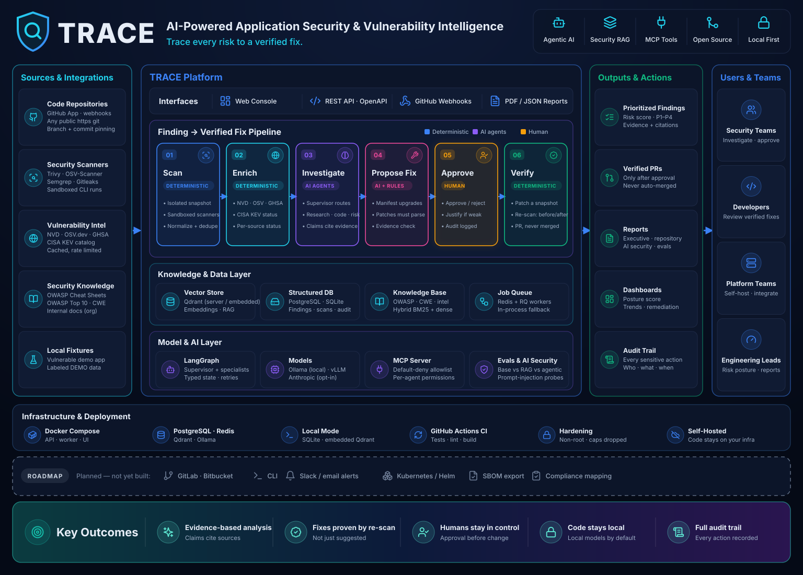
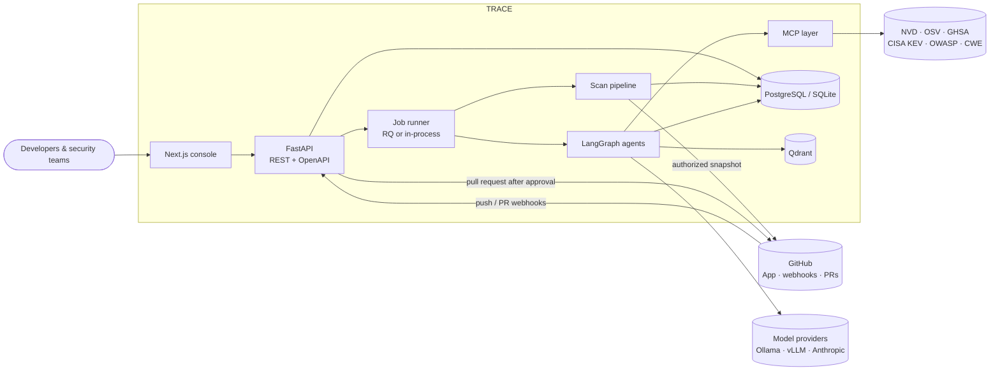
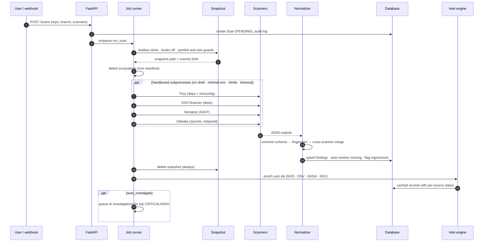
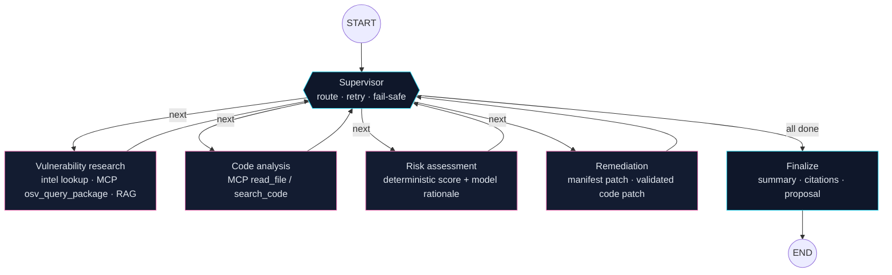
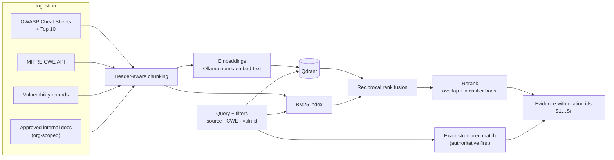
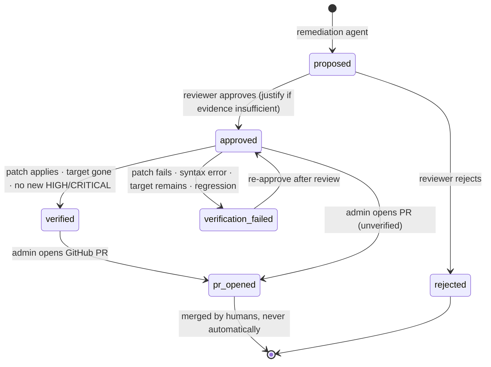
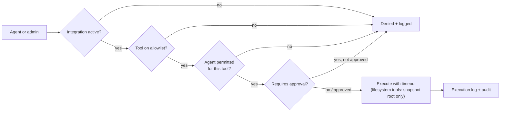
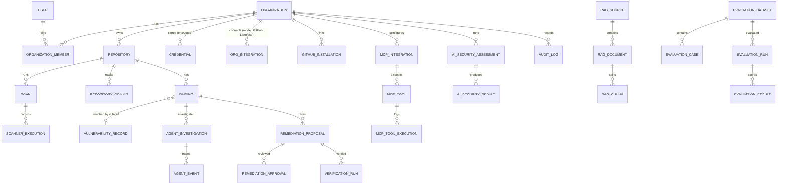
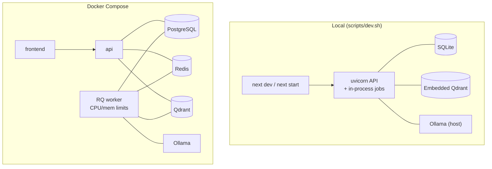

# TRACE Architecture

> Trace every risk to a verified fix.



- [1. System context](#1-system-context)
- [2. Scan pipeline](#2-scan-pipeline)
- [3. Agent investigation graph](#3-agent-investigation-graph)
- [4. Retrieval (security RAG)](#4-retrieval-security-rag)
- [5. Remediation lifecycle](#5-remediation-lifecycle)
- [6. MCP tool permissions](#6-mcp-tool-permissions)
- [7. Data model](#7-data-model)
- [8. Deployment topologies](#8-deployment-topologies)
- [9. Repository layout](#9-repository-layout)

---

## 1. System context



## 2. Scan pipeline



An unavailable scanner is recorded as `unavailable`, never replaced with synthetic results. A scan with some failed scanners is `PARTIAL`.

## 3. Agent investigation graph



**What the agents may and may not decide:**

| Comes from structured data (never the model) | Comes from the model (labeled, citation-checked) |
|---|---|
| CVSS, fixed versions, KEV status, exploit refs | Summary, attack path, impact explanation |
| Risk score and priority (P1–P4) | Root cause, remediation rationale |
| Manifest upgrade patches | Code patch proposals (must parse; definitions preserved) |

Untrusted inputs (code, scanner text, retrieved documents) are wrapped as data and screened for injection markers. Source code is withheld from hosted models unless `ALLOW_SOURCE_TO_HOSTED_LLM=true`.

## 4. Retrieval (security RAG)



## 5. Remediation lifecycle



Verification applies the patch with `git apply` to a fresh snapshot, syntax-checks changed files, and re-runs only the relevant scanners before and after. Repository code and tests are never executed; CI on the PR covers that.

## 6. MCP tool permissions



Servers come only from an allowlisted registry or remote HTTPS URLs added by an admin. New tools are denied by default.

## 7. Data model



Every tenant-owned row carries `organization_id`; every query is scoped to the caller's organization and role.

## 8. Deployment topologies



All containers run as non-root with `no-new-privileges` and every capability dropped.

## 9. Repository layout

```text
trace/
├── backend/                      FastAPI service (Python 3.12)
│   ├── app/
│   │   ├── main.py               app factory · middleware · health/ready · startup recovery
│   │   ├── api/
│   │   │   ├── common.py         serialization · pagination · org-scoped lookups
│   │   │   └── endpoints/        auth · organizations · repositories · scans · findings · intel
│   │   │                         agents · rag · mcp · ai_security · evaluations · remediation
│   │   │                         reports · dashboard · system · webhooks
│   │   ├── core/                 config · database · auth deps (RBAC) · security · logging · loop_lock
│   │   ├── db/
│   │   │   ├── models.py         32-table normalized schema
│   │   │   └── seed/             demo admin · org · fixture repository
│   │   ├── scanners/             runner (sandbox) · adapters (Trivy/OSV/Semgrep/Gitleaks)
│   │   │                         ecosystems · normalize (schema, fingerprints, dedupe)
│   │   ├── services/             scan_service · snapshot · patching · remediation_service
│   │   │                         ai_security · reports (PDF/JSON) · jobs · audit
│   │   ├── intel/                NVD · OSV · GHSA · CISA KEV aggregation and cache
│   │   ├── rag/                  ingestion · chunking · embeddings · hybrid retrieval
│   │   ├── agents/               LangGraph graph · prompts and injection defense · service
│   │   ├── llm/                  Ollama · OpenAI-compatible (vLLM) · Anthropic providers
│   │   ├── mcp/                  MCP client · registry · permissions · execution log
│   │   ├── mcp_servers/          trace_security: built-in MCP server (stdio)
│   │   ├── evals/                datasets · runner · security metrics
│   │   └── integrations/         registry: UI-managed per-org integrations (schema, encrypted
│   │                             storage, live verification, provider resolution, 409 gate)
│   │                             github: App · tokens · branches · pull requests
│   ├── alembic/versions/         0001 schema · 0002 rebrand data migration · 0003 org integrations
│   ├── tests/
│   │   ├── test_units.py         parsers · dedupe · patching · risk · guards · concurrency
│   │   ├── test_api.py           auth · org isolation · webhooks · approval gates · MCP allowlist
│   │   ├── test_integrations.py  integration storage · verification · gating · roles · env fallback
│   │   ├── test_e2e.py           scan → investigate → approve → verify (real scanners)
│   │   └── fixtures/vulnerable-app/   intentionally vulnerable demo target (never deploy)
│   ├── requirements.txt
│   └── Dockerfile                pinned scanners · non-root user
├── frontend/                     Next.js 14 App Router (TypeScript)
│   ├── app/                      overview · repositories · scans · vulnerabilities · investigations
│   │                             intelligence · ai-security · mcp · remediation · evaluations
│   │                             reports · settings · login
│   ├── components/               ui primitives · app shell · findings table · investigation view
│   │                             integrations panel · "set up first" prompt and banner
│   │   └── dashboard/            charts · posture gauge · lists
│   ├── lib/                      API client (auth, org header, downloads, integration_required
│   │                             interception) · integrations hooks · utils
│   └── Dockerfile                standalone build · non-root user
├── docs/
│   ├── ARCHITECTURE.md           this document
│   ├── STATUS.md                 verified vs. pending, known limitations
│   └── architecture.svg          overview diagram
├── scripts/
│   ├── install-tools.sh          uv · Trivy · Gitleaks · OSV-Scanner · Semgrep into .tools/
│   ├── dev-setup.sh              one-time local setup
│   └── dev.sh                    run API + frontend
├── docker-compose.yml            PostgreSQL · Redis · Qdrant · Ollama · API · worker · frontend
├── .env.example                  every configuration option, documented
├── LICENSE · SECURITY.md · CONTRIBUTING.md
├── .github/workflows/ci.yml      backend tests · frontend lint/type-check/build
└── README.md
```
